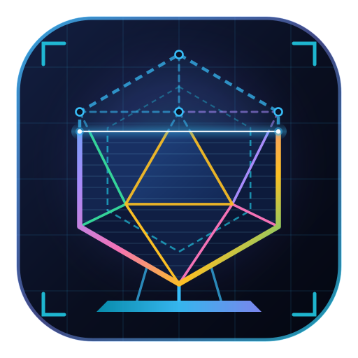

<p align="center">
  
</p>

<h1 align="center">Dice Chaos Masters</h1>

<p align="center">
  <strong>Free Offline Parametric 3D Polyhedral Dice Master, Matched Insert Blank &amp; MSLA Support Studio</strong>
</p>

<p align="center">
  <a href="https://github.com/dicechaos/DiceChaosMasters/releases"></a>
  <a href="https://github.com/dicechaos/DiceChaosMasters/actions"></a>
  <a href="https://dicechaos.com"></a>
  <a href="https://github.com/dicechaos/DiceChaosConnections"></a>
  <a href="https://github.com/dicechaos/DiceChaosDisplay"></a>
  <a href="./LICENSE"></a>
</p>

---

**Dice Chaos Masters** is a free, local-first parametric CAD studio built by **[Dice Chaos](https://dicechaos.com)** for handmade dicemakers, 3D printer tinkerers, and resin casters. Design watertight polyhedral master sets (`D2` through `D20`), automatically paired **insert blanks** calculated to exact caliper clearance, and automated **point-down MSLA resin supports** in one self-contained desktop studio—with custom typography, `.svg` face emblems, zero accounts, and zero subscriptions.

> **Part of the Dice Chaos Tabletop Suite:** Built side-by-side with **[Dice Chaos Connections](https://github.com/dicechaos/DiceChaosConnections)** (offline campaign mind-map, conspiracy board & 2nd-screen lore display) and **[Dice Chaos Display](https://github.com/dicechaos/DiceChaosDisplay)** (4K/8K tabletop TV battlemap studio with true 1-inch physical miniature calibration). Craft your custom dice masters at **[dicechaos.com](https://dicechaos.com)** with *Masters*, organize your world in *Connections*, and roll real physical resin sets under your miniatures in *Display*. Found a bug or have a feature request? [Open an issue on GitHub](https://github.com/dicechaos/DiceChaosMasters/issues).

---

## Download & Install

Grab the latest **Public Beta (`v1.0.0-beta.4`)** installers or portable packages from **[GitHub Releases](https://github.com/dicechaos/DiceChaosMasters/releases)**:

- **Windows (x64):**
  - `dice-chaos-masters-1.0.0-beta.4-setup.exe` *(NSIS installer with Start Menu & Desktop shortcuts)*
  - `dice-chaos-masters-1.0.0-beta.4-win-x64-portable.zip` *(Extract anywhere and run `DiceChaosMasters.exe`)*
- **macOS (Apple Silicon & Intel):**
  - `dice-chaos-masters-1.0.0-beta.4-arm64.dmg` / `dice-chaos-masters-1.0.0-beta.4-x64.dmg` *(Disk image installers)*
  - `dice-chaos-masters-1.0.0-beta.4-mac-arm64.zip` / `dice-chaos-masters-1.0.0-beta.4-mac-x64.zip` *(Portable macOS bundles)*
- **Linux (x64):**
  - `dice-chaos-masters-1.0.0-beta.4.AppImage` or `dice-chaos-masters_1.0.0-beta.4_amd64.deb`

> **Windows SmartScreen / macOS Gatekeeper Note:** Because Public Beta builds are not yet signed with a commercial EV certificate:
> - **Windows:** If *"Windows protected your PC"* appears on first launch, click **More info** -> **Run anyway**.
> - **macOS:** Right-click (or Control-click) the app -> **Open** on first launch.

---

## Key Features

### Full 12-Shape Polyhedral Set, Custom Variants & Multi-Instance Sets (`D2` – `D20`)
- **Complete 12-Shape Studio:** `D2` Coins (6 silhouettes: *Round*, *Oval*, *Rounded Square*, *Hexagon*, *Octagon*, *Shield Crest*), `D3` (*Truncated Barrel* & *Rounded Prism*), `D4` (**6 variants:** *Crystal Shard*, *Arch / Barrel*, *Pendulum Drop*, *Truncated Tet*, *Classic Vertex*, *Classic Base*), odd-sided `D5` / `D7` / `D9` (*Trapezohedron 2×*, *Crystal Barrel 2×*, *Zocchi Prism 1×*), `D6` (*Standard*, *Crystal Barrel*, *Rhombic Diamond*, *Truncated Cube*), `D8` (*Octahedron*, *Gem Shard*, *Crystal Barrel*), `D10` (`0–9` or `1–10` + *Crystal Barrel*), `D00` (`horizontal` or `vertical` alignment + *Crystal Barrel*), `D12` (*Pentagonal*, Catalan *Rhombic D12*, *Crystal Barrel*), and `D20` (*Balanced* or *Spindown*).
- **Multi-Instance Sets & Quick Game Set Templates:** Add duplicate dice in one project (such as Logo + Numbers `2× D6` or `2× D20` pairs) or apply 1-click **Quick Game Set Templates** (*Classic RPG 7*, *Twin D20 Advantage 8*, *Coin + Twin D6/D20 10-Die Set*, *Catalan Rhombic 7*, *Crystal Barrel 7*, *DCC Weird Chain 10*, *Full 12-Shape Continuum*).
- **Multi-Die Selection, Group Editing & Context Menus:** Multi-select across the left rail and 3D tray (`All`, `RPG 7`, `Multi`, `Ctrl/Cmd+Click`, `Shift+Click`) for real-time relative/uniform caliper scaling, shared chamfer/clearance/font overrides, and `Selected Group` export; right-click (or `Shift+F10`) dice, faces, and `Faces: All` for fast batch edits, plus confirm-gated die removal.
- **Precision Face-to-Face Caliper Sizing & Batch Controls:** Tune global or per-die caliper dimensions, edge chamfer radius, crystal elongation ratios, and silicone/resin shrinkage compensation (`%`).

### True `0.00 mm` Sharp-Edge & Chamfered `manifold-3d` CSG Kernel
- **Watertight Boolean Engine:** Powered by `manifold-3d` WASM CSG booleans so every engraved master, insert blank, and supported build plate exports as an exact watertight `.stl` or `.3mf` mesh ready for Lychee, Chitubox, or PrusaSlicer.
- **Hard-Edge Precision at `0.00 mm`:** Crisp crease-split facet viewport normals showcase sharp `0.00 mm` edges and fine chamfered bevels alike without smoothing artifacts while keeping exported geometry cleanly welded.

### Typography, Installed OS Fonts & Custom Face SVGs
- **5 Bundled Display Fonts + OS Font Discovery:** Ships offline with 5 Open Font License display/fantasy/sci-fi fonts and automatically discovers installed OS `.ttf` and `.otf` typefaces in Electron desktop mode—or drag and drop any custom `.ttf` / `.otf` file straight onto the studio window.
- **Draft-Angle Engraving & Face Overrides:** Adjustable engraving depth and tapered draft walls for cleaner silicone mold demolding, optional `6`/`9` dot or underline orientation markers, and per-face text/custom `.svg` emblem replacement, offset, and rotation.

### Matched Insert Blanks & Real-Time Breach Verification
- **Calibrated Inner Blanks (`Insert X-Ray`):** Automatically computes matched inner insert blanks using exact opposing-face caliper geometry:
  $$\text{BlankSize} = \text{MasterSize} - 2 \times (\text{EngraveDepth} + \text{Clearance})$$
- **Real-Time Shell Breach Checks:** Verifies every die numerically before export and alerts immediately if deep numerals or high relief push through an insert wall.

### Point-Down MSLA Resin Supports & Batch Mold-Ready Export
- **Automated Point-Down Supports:** Generates point-down fin and edge-bumper support structures grounded cleanly at `Z = 0` for sharp-edge MSLA resin printing.
- **1-Click Production Bundle:** Exports organized `Masters/`, `Blanks/`, and a generated `CALIPER_SPEC.md` manufacturing summary sheet, plus self-contained `.dcproj` studio project files.

### Suite-Aligned Studio Ergonomics
- **Midnight-Sapphire Dark & Daylight Light Themes:** Matches the Dice Chaos Suite palette via adaptive `light-dark()` tokens with automatic system preference sync.
- **4 3D Resin Material Presets:** Preview masters in **Master Grey**, **Arcane Sapphire**, **Cure Clear**, and **Obsidian** shaders with responsive `Fit (F)` camera framing and distraction-free `Focus (\)` mode.
- **50-Step Coalesced Undo/Redo & Auto-Save:** Smooth slider edits coalesce into clean 50-step Undo/Redo history (`Ctrl+Z` / `Ctrl+Y`), backed by atomic `.dcproj` Save / Save As / debounced Auto-Save, unsaved-changes quit protection, window drag-and-drop (`.dcproj`, `.ttf`, `.otf`, `.svg`), and an interactive **5-Step Maker Tour**.

---

## Quick Shortcuts

| Shortcut / Gesture | Action |
| :--- | :--- |
| **`Ctrl + Z`** / **`Ctrl + Y`** | Undo / Redo edit (50 steps) |
| **`Ctrl + S`** / **`Ctrl + Shift + S`** | Save / Save As `.dcproj` project |
| **`Ctrl + O`** | Open `.dcproj` archive |
| **`Ctrl + E`** | Open Batch Export dialog |
| **`Ctrl + A`** / **`Shift + Click`** | Multi-die group selection (`Esc` collapses to Single) |
| **`Right-Click`** / **`Shift + F10`** | Die, Face & `Faces: All` context menu |
| **`Delete`** | Remove selected dice (with confirmation dialog) |
| **`1`** / **`2`** / **`3`** / **`4`** | Single Die / Full Tray / Insert X-Ray / Supports |
| **`F`** | Fit & reset 3D camera |
| **`\`** | Toggle unobstructed Focus Mode |
| **`?`** or **`F1`** | Open Shortcuts & Dice Chaos Suite guide |

---

## Development & Building From Source

Requires **Node.js 20+** and **npm**.

```bash
# Install dependencies
npm install

# Run Electron desktop studio in development mode
npm run dev

# Run pure web browser dev server (Vite)
npm run dev:web

# Run CAD geometry & watertightness tests (Vitest + manifold-3d)
npm run test

# Typecheck Node (Electron) + Web (Renderer/Engine)
npm run typecheck

# Typecheck & build production bundles
npm run build

# Regenerate multi-resolution app icons from scripts/generate-icons.cjs
npm run icons

# Package OS installers (outputs to release/)
npm run build:win     # Windows (.exe NSIS installer & portable .zip)
npm run build:mac     # macOS (.dmg & macOS .zip)
npm run build:linux   # Linux (.AppImage & .deb)
```

---

## Links & Feedback

- **Handmade Dice & Tabletop Gear:** [dicechaos.com](https://dicechaos.com)
- **Companion Campaign & Conspiracy Studio:** [Dice Chaos Connections](https://github.com/dicechaos/DiceChaosConnections)
- **Companion 4K/8K TV Battlemap Studio:** [Dice Chaos Display](https://github.com/dicechaos/DiceChaosDisplay)
- **Bug Reports & Feature Requests:** [GitHub Issues](https://github.com/dicechaos/DiceChaosMasters/issues)
- **License:** MIT License — Copyright © 2026 dicechaos (Gus). See [LICENSE](./LICENSE).
